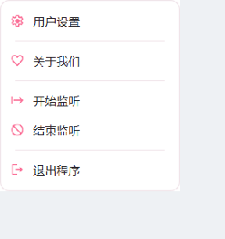
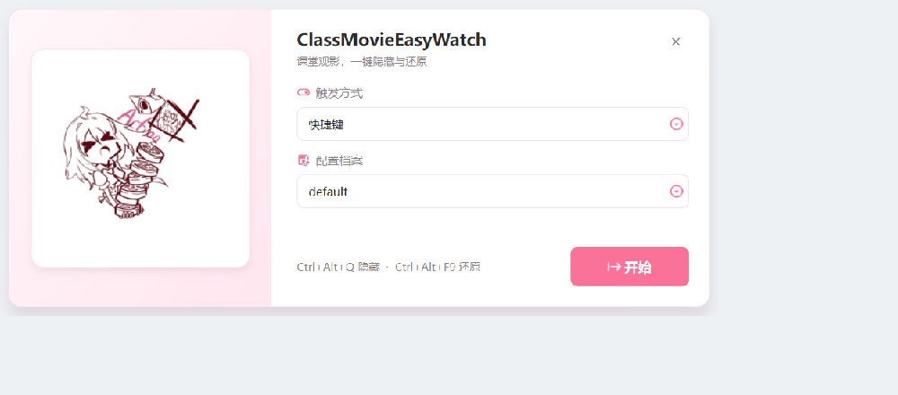
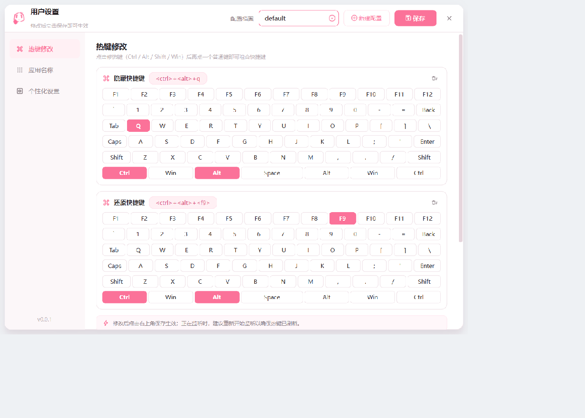
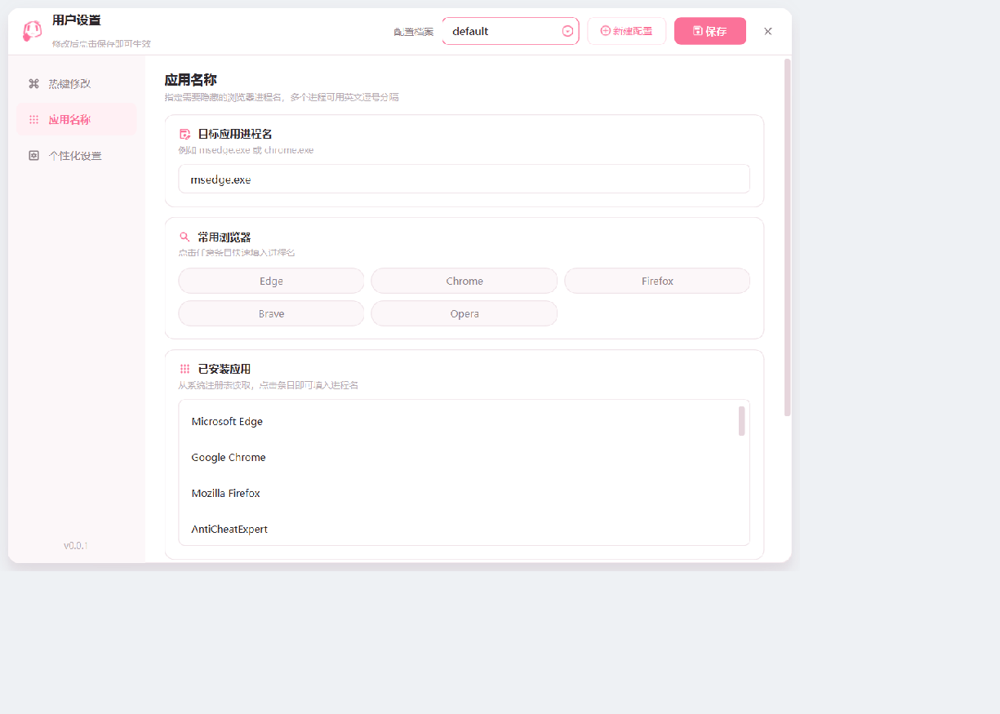
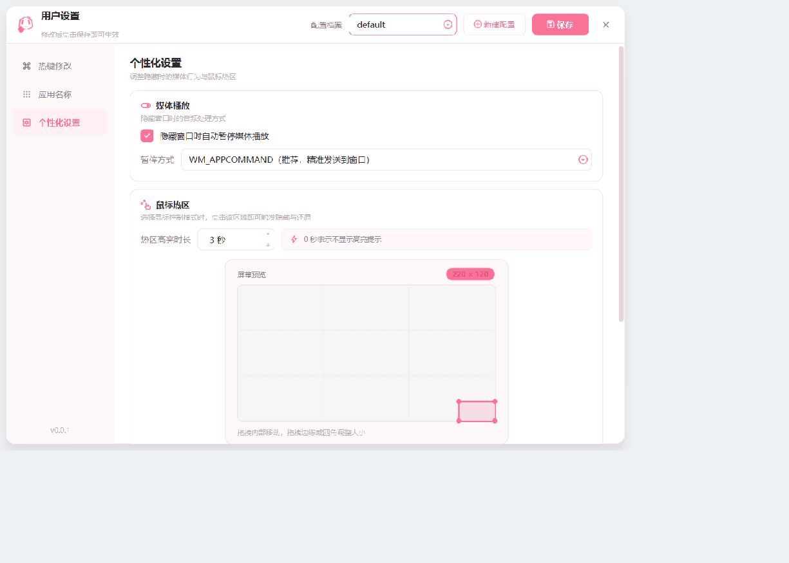
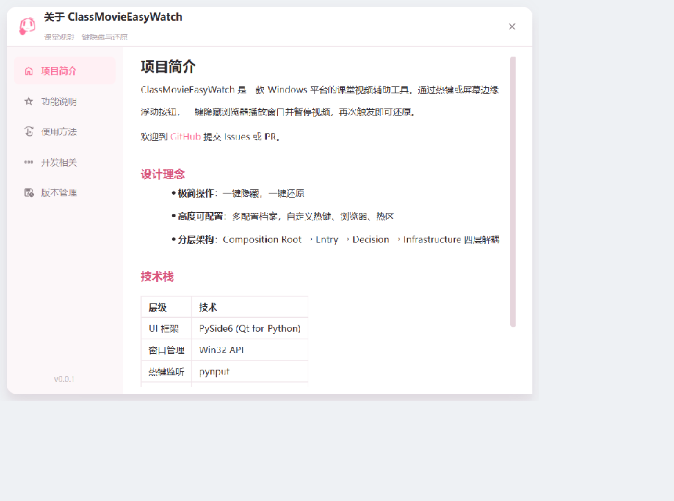

# ClassMovieEasyWatch

课堂观影一键隐藏 / 还原工具。支持全局热键和鼠标点击触发两种触发方式。

>期末考试之后通常是一个需要放松的时间，比如在班上晚自习的时候看看电影之类的。。。但是知周所众，晚自习有老师巡堂。如果是在家里，我们通常可以按下Win + D将所有前台窗口最小化，但是在学校的一体机上就会出现一个问题：一体机是一个触屏设备，按快捷键还有些麻烦，因此这个项目拥有鼠标点击触发模式，为这个问题提供了一个可能的解决方案。


---
## 运行截图

**托盘菜单**



**开始监听**



**设置界面 · 热键修改**



**设置界面 · 应用名称**



**设置界面 · 个性化设置**



**关于界面**



## 功能

- 热键或鼠标热区一键隐藏浏览器窗口，同时暂停视频 + 静音
- 再次触发还原窗口，恢复音量
- 状态机防抖，编排器按序执行
- 配置热加载，设置保存后即时生效
- 多配置档案，自定义热键、浏览器、热区
- 系统托盘，预飞检查，Toast 提示
- 无边框圆角卡片界面，图标全部来自项目内置矢量素材

## 依赖

```
pynput    pywin32    psutil    Pillow
PySide6   pycaw
```

```bash
pip install -r requirements.txt
```

## 快速开始

```bash
git clone https://github.com/Imgreenhand/ClassMovieEasyWatch.git
cd ClassMovieEasyWatch
pip install -r requirements.txt
python main.py
```
运行后系统托盘处出现一个图标，
右键托盘图标 →「开始监听」→ 选择触发方式和配置 →「开始」。

默认热键：`Ctrl+Alt+Q` 隐藏 / `Ctrl+Alt+F9` 还原。

## 配置说明

配置文件位于 `%APPDATA%/Roaming/ClassMovieEasyWatch/`，每个 `.json` 文件对应一个配置档案：

```json
{
    "name": "default",
    "hotkey_hide": "<ctrl>+<alt>+q",
    "hotkey_restore": "<ctrl>+<alt>+<f9>",
    "browser_names": "msedge.exe",
    "auto_pause": true,
    "hotspot_width": 220,
    "hotspot_height": 120,
    "hotspot_x": 1.0,
    "hotspot_y": 1.0,
    "pause_method": "appcommand",
    "highlight_seconds": 3
}
```

| 字段 | 说明 |
|------|------|
| `hotkey_hide` | 隐藏热键（pynput 格式） |
| `hotkey_restore` | 还原热键 |
| `browser_names` | 目标浏览器进程名 |
| `auto_pause` | 隐藏时是否自动暂停 |
| `pause_method` | `appcommand`（推荐）或 `keybd_event` |
| `hotspot_*` | 热区大小和位置 |

用户偏好存储在 `save.txt`，记录触发方式和当前配置档案名。

## 项目结构

```
ClassMovieEasyWatch/
├── main.py                     # Composition Root
├── entry/                      # Entry Layer
│   ├── gui_logic.py
│   └── listen_logic.py
├── decision/                   # Decision Layer
│   ├── interfaces.py
│   ├── finite_state_machine.py
│   └── orchestrator.py
├── infrastructure/             # Infrastructure Layer
│   ├── thread_pool.py
│   ├── mailbox.py
│   ├── window_manager.py
│   ├── media_control.py
│   ├── browser_finder.py
│   ├── hotkey_listener.py
│   ├── data_manager.py
│   ├── path_utils.py
│   └── version.py              # 版本号
├── GUI/                        # GUI 组件
│   ├── theme.py                # 主题、样式表与矢量图标
│   ├── widgets.py              # 侧边栏导航等公共组件
│   ├── toast.py                # Toast 提示
│   ├── StartWindow.py          # 开始窗口
│   ├── FloatingButton.py       # 热区触发与高亮浮层
│   ├── AboutWindow.py          # 关于窗口
│   ├── SettingMainScroll.py    # 设置页内容
│   └── Art/                    # 插画素材与矢量图标
├── SettingWindow.py            # 设置窗口
├── SaveData/default.json       # 配置模板
└── About/                      # 关于页面
```

## 版本

[v0.0.1](https://github.com/Imgreenhand/ClassMovieEasyWatch/releases) (2026-10) — 界面重构：统一主题、矢量图标、圆角卡片窗口

[v0.0.0](https://github.com/Imgreenhand/ClassMovieEasyWatch/releases/tag/0.0.0) — 初始版本发布
